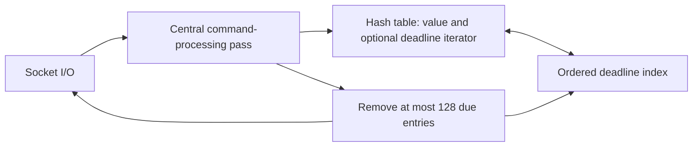

# Step 5: Investigate Design Trade-offs

Status: expiration design selected below; other concerns remain open.

Extend the design one concern at a time. For each concern, describe the problem,
compare alternatives, choose an approach, and record its costs and guarantees.

| Concern | Questions to explore |
| --- | --- |
| Concurrency | What work can block the event loop? When would additional threads help? |
| Expiration | How do we detect expired keys and reclaim untouched entries without long pauses? |
| Memory limits | How do we account for memory? When should we evict keys or reject writes? |
| Persistence | Snapshots, logs, or both? When do we acknowledge writes, and what can a crash lose? |
| Replication | How do replicas synchronize and catch up? What happens to reads and writes during failover? |
| Sharding | How do we assign and move keys, route requests, and handle hot keys? |

Follow the progression in [scope.md](scope.md): bounded memory, persistence,
replication, then sharding. Revisit concurrency as each addition creates new work.

Deliverable: a short decision record for each concern, with an updated diagram
where the architecture changes. Decisions remain open until that phase is studied.

## Key Expiration Decision (Issue #2)

Support `SET key value PX milliseconds` with an integer TTL in the range
1–31,536,000,000 ms (365 days). Reject zero, negative, noninteger, overflowing,
out-of-range TTLs, unknown options, and incorrect arity before changing the key.
Only uppercase `PX` is supported. A successful SET replaces both value and TTL;
SET without PX clears an earlier TTL. DEL removes the value and its deadline.

Use `std::chrono::steady_clock`: a deadline is measured from command execution,
and a key is absent when `now >= deadline`. Clock changes do not extend or shorten
its lifetime. GET removes an expired key and returns null; DEL removes it but
returns zero because it was already logically absent. Deadlines are not persisted;
their meaning across restart belongs to the persistence phase.

Access-only expiration leaves untouched values resident indefinitely. Scanning
the whole hash table can pause the event loop. Instead maintain a deadline-sorted
`std::multimap` with one entry per expiring key and an iterator in the stored
entry. Replacements/deletions remove the old index entry, avoiding stale timers
and unbounded metadata growth from repeated TTL updates. Insert/update costs
O(log T) for T expiring keys; this adds tree-node overhead and a duplicate key.
A lazy min-heap would be simpler to append to but needs stale-entry compaction;
a timing wheel offers cheaper operations at the cost of more scheduling logic.

Each event-loop iteration first handles socket events, then processes commands
at the existing single central point, then removes at most 128 expired entries.
No background thread is introduced. Expired keys are immediately absent on access
even if this cleanup budget leaves a backlog. Idle polling currently waits up to
10 ms, so physical reclamation can lag deadlines, particularly during a burst.
The cleanup budget bounds entry count, not wall-clock duration or allocator cost.
New values and deadlines are prepared before replacing an existing entry.

Validate exact deadline boundaries using an explicit test time, plus socket-level
replacement/validation tests. An expiration-burst experiment will probe PING
latency while untouched TTL values become due and sample process RSS. Store tests
must verify actual entry/index reclamation: allocator-retained RSS alone cannot
prove whether keys remain resident. Dataset limits and eviction remain issue #3.
