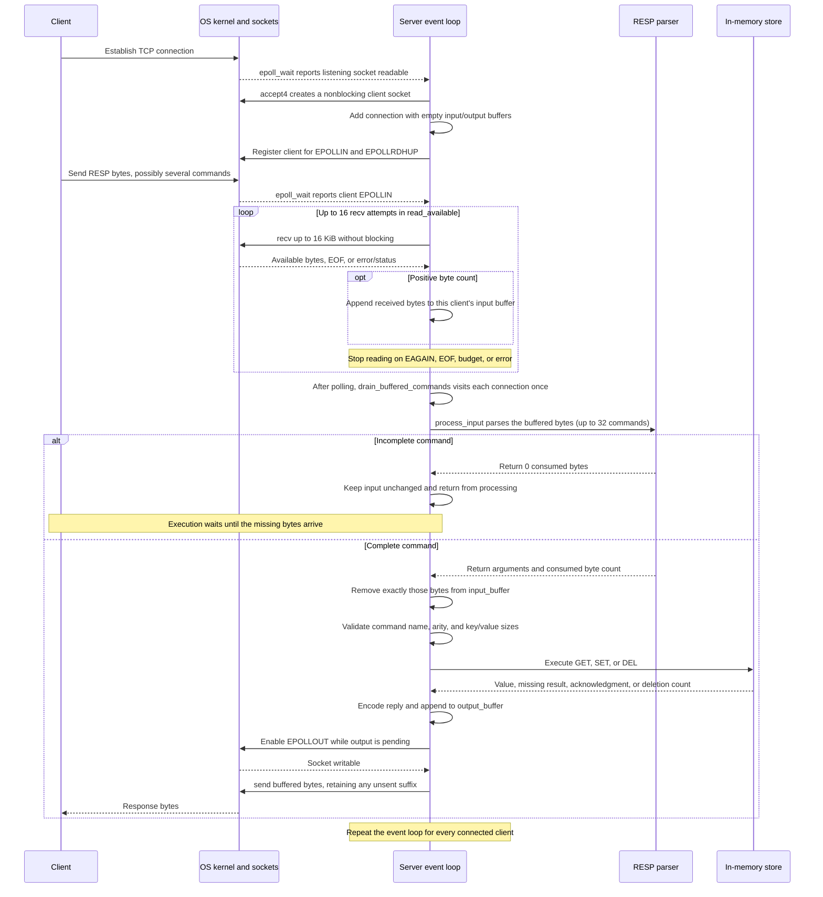
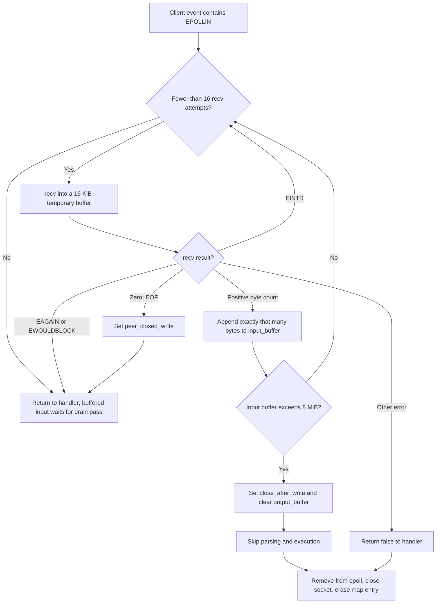
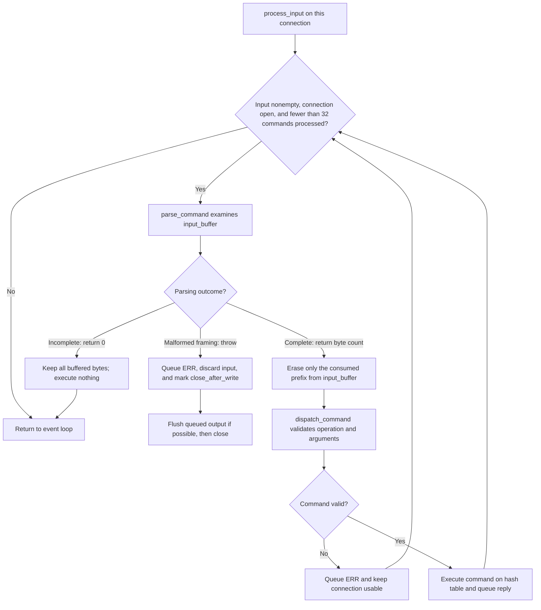

# Step 4: Implementation and Test Report

## Implemented Scope

The [C++ prototype](prototype/README.md) implements the minimal single-node design:

- One OS thread running an epoll event loop.
- Nonblocking TCP acceptance, reads, and writes.
- Per-client input/output buffering, complete-command parsing, and partial writes.
- GET, SET, and DEL over an in-memory hash table, with PING for readiness.
- Binary-safe RESP framing, per-connection command order, and bounded work per pass.
- Request-size, connection-count, and per-client buffer limits.

`Server::run()` polls sockets and drains buffered commands. There are no upstream
connections, background storage tasks, or replication roles.

Expiration, eviction, persistence, replication/failover, and sharding remain
future studies. Their source files, control scripts, command-line options, and
old test/benchmark artifacts have been removed. Their brief documentation and
GitHub issues remain available for future work.

## Structure

| Component | Purpose |
| --- | --- |
| Configuration | Parse/validate --port before constructing Server |
| Event loop and connection state | Accept clients, maintain epoll interest, and handle partial I/O |
| Protocol parser | Assemble complete RESP commands across arbitrary TCP reads |
| Command executor | Validate and execute PING/GET/SET/DEL sequentially |
| Store | Map byte-string keys to byte-string values |

The [source reading guide](prototype/README.md#read-the-code) links these components.

## Command Flow: From Client Bytes to a Reply

The server receives a stream of bytes. A successful `recv()` does not imply that
one whole command arrived. Reading, parsing, and executing are separate steps.
The diagrams below trace the current step-4 implementation.

### 1. End-to-End Request

`Event loop`, `Parser`, and `Store` below are functions/components on the same
server thread. The kernel owns the listening queue and socket receive/send buffers.



This sequence shows a normal readable event. The read/error branches below
specify when the server stops reading or closes the socket. Socket handlers write
previously queued replies on `EPOLLOUT`; replies generated by the drain pass wait
for a later writable event.

### 2. How the Server Reads a Ready Socket

This is [read_available()](prototype/src/server_network.cpp), called by
`handle_socket_event()` when `EPOLLIN` is present. It reads bytes into memory;
command execution happens in the drain pass after network polling returns.



The important distinctions are:

| Outcome | Meaning | What the server does |
| --- | --- | --- |
| Positive byte count | Some bytes are available, regardless of command boundaries | Append them, then attempt another read within the budget |
| EAGAIN / EWOULDBLOCK | No more bytes are available right now | Stop reading and parse what is already buffered; keep the connection |
| EINTR | A signal interrupted the call | Try again if attempts remain |
| Zero | The peer has closed its sending side | Stop reading, but allow complete buffered commands and their replies to finish |
| Other error | The read failed | Close and remove the connection |

Each read invocation makes at most 16 attempts of up to 16 KiB, or at most
256 KiB of newly read data. This **work budget** yields to other connections; it
does not close the socket. With level-triggered epoll, unread bytes still in the
kernel receive buffer produce readiness again on a subsequent poll.

The separate **8 MiB accumulated input limit** is a connection policy. Exceeding
it discards pending output and closes the connection. Because output is cleared,
the cleanup does not wait for the client to receive it. Even a well-framed large
pipeline can hit this bound; the condition does not itself prove malformed RESP.

### 3. How Buffered Bytes Become Commands

[process_input()](prototype/src/server_network.cpp) calls
[parse_command()](prototype/src/protocol.cpp). The parser checks the RESP array
header, then each bulk-string length, payload, and trailing CRLF. Its result
determines whether the server can execute anything.



A framing error closes the connection after queued output is flushed because
the server stops trusting command boundaries. A valid RESP frame containing an
unknown command, wrong arity, or oversized key/value receives an error while the
connection remains usable. In both cases the rejected command does not execute.

The limit is **32 commands per connection per event-loop iteration**.
`drain_buffered_commands()` is the only caller of `process_input()` and visits
each connection once. If a pipeline leaves complete commands in `input_buffer`,
the next iteration's drain pass continues them without requiring another client
write. If only a partial command remains, later attempts still return zero until
more bytes arrive.

### 4. Example: A Partial Command Followed by a Pipeline

For illustration, suppose two reads return these bytes. `\r\n` below denotes
actual CRLF bytes; the client cannot rely on TCP preserving these read boundaries.

```text
Read 1: *2\r\n$3\r\nGET\r\n$4\r\nna
Read 2: me\r\n*2\r\n$3\r\nGET\r\n$5\r\nother\r\n
```

1. Append read 1. The parser sees a four-byte key but has only `na`, so it returns
   zero. The server keeps all bytes; it does not look up `na`.
2. Append read 2. The buffer now contains two complete commands: `GET name` and
   `GET other`.
3. Parse and execute `GET name`. Erase its byte prefix and queue its reply.
4. Parse and execute `GET other` from the remaining bytes. Queue its reply after
   the first. No additional socket read is required between those commands.

`recv()` may also supply both chunks during one `read_available()` call. In that
case parsing begins after reading stops, with both complete commands already in
the input buffer.

### 5. Sending Replies and Closing

`queue_reply()` appends encoded responses in execution order and enables
`EPOLLOUT`. `write_available()` sends at most 256 KiB per invocation, advances
`output_offset`, and retains unsent bytes when the socket cannot accept more.
When output is exhausted, the buffer is cleared and write interest is disabled.
The bound on pending output is also 8 MiB; overflow drops it and marks the
connection for closure.

For a peer half-close, the server processes complete buffered commands, discards
any final incomplete command, and closes after queued replies finish. Socket
errors and full hang-up also have cleanup paths in `handle_socket_event()`.
Every normal close uses `close_connection()`: remove epoll registration, close
the descriptor, and erase the connection and its buffers from `connections_`.

## Verification

The integration suite has eight scenarios:

1. Basic commands, binary/empty values, replacement, and one OS thread.
2. Fragmented requests, ordered SET/GET pipelines, and half-close.
3. Malformed framing, oversized declared lengths, and truncated requests.
4. Eight concurrent clients alongside idle/slow clients, including 1 MiB replies.
5. Invalid commands and sizes preserving the existing value and connection usability.
6. Abrupt resets and repeated connection/descriptor reuse.
7. A killed process restarting with an empty dataset.
8. CLI validation and rejection of later-phase commands/options.

All eight scenarios pass in both builds:

| Build | Scenarios | CTest time | Diagnostics |
| --- | --- | --- | --- |
| Release | 8 passed | 0.35 s | None |
| AddressSanitizer + UBSan | 8 passed | 0.41 s | No sanitizer diagnostics |

Recorded output: [release](prototype/results/step4-release-tests.txt) and
[sanitizer run](prototype/results/step4-sanitizer-tests.txt).

## Reproduction

From `redis/prototype/`:

```sh
cmake -S . -B build -DCMAKE_BUILD_TYPE=Release
cmake --build build -j2
ctest --test-dir build -V

cmake -S . -B build-asan -DCMAKE_BUILD_TYPE=Debug -DSANITIZE=ON
cmake --build build-asan -j2
ctest --test-dir build-asan -V
```

Tests start temporary localhost servers and clean them up. Throughput, p99
latency, and the ten-million-key capacity assumptions have not been validated
for this baseline. The earlier benchmarks for the expanded implementation do
not describe this prototype and have been removed.
