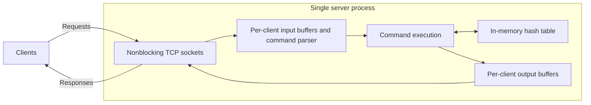
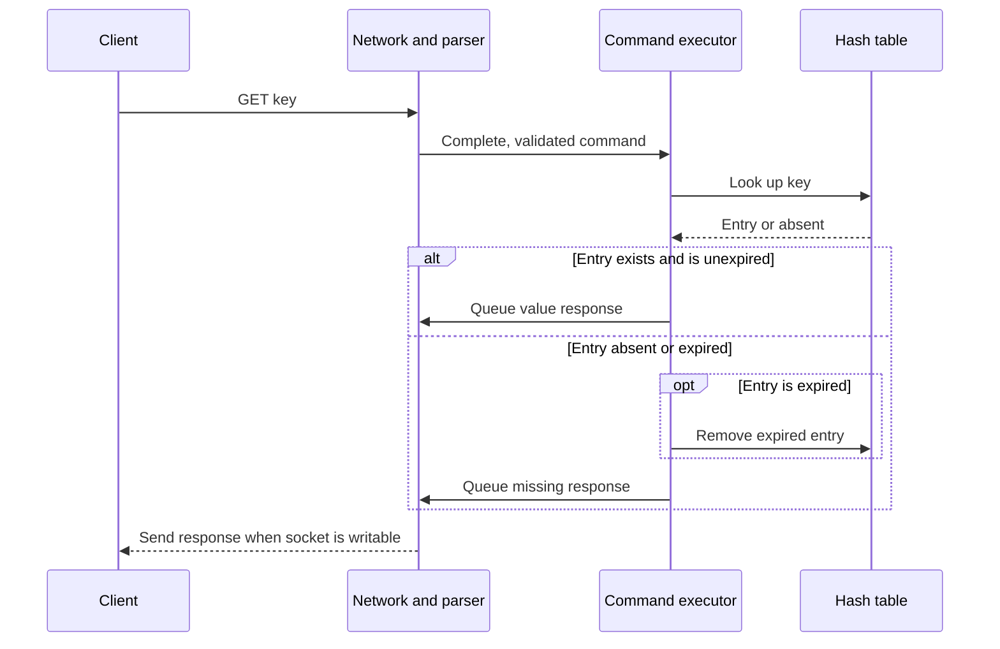
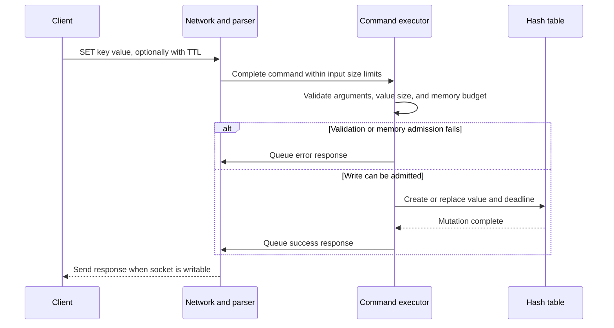

# Minimal Single-Node Design

This document covers step 4: sketch a minimal design and explain its read and
write paths. It proposes a Redis-like store based on our
[requirements and capacity estimates](requirements-and-capacity.md). These are
our design decisions; comparison with a specific Redis version comes later.

## Architecture

Start with one process, an in-memory hash table, and one event loop that owns all
mutable state. Clients connect over TCP and send framed commands. A Redis-compatible
prototype can use RESP framing for the small command subset we support.



The boxes represent responsibilities within the same event loop, not separate
threads or services. Socket readiness lets the loop serve many connections
without waiting for an individual client to send or receive data.

| Component | Responsibility |
| --- | --- |
| Network handling | Accept connections and read/write available bytes without blocking |
| Input buffer and parser | Assemble complete commands across TCP reads; validate framing and size limits |
| Command execution | Validate arguments and execute one complete command at a time |
| Hash table | Map each key to a string value and an optional expiration deadline |
| Output buffer | Hold encoded responses until the socket can accept them |

TCP preserves byte order but does not preserve command boundaries. A read may
contain part of a command or several commands. Keep incomplete input buffered and
execute complete commands in their order on each connection.

## Data Model and Command Semantics

```text
key -> { value: bytes, expires_at: optional deadline }
```

- `GET key` returns the value, or a missing result if absent or expired.
- `SET key value [TTL]` creates or replaces the whole entry. A positive TTL sets a
  new deadline; omitting TTL clears any previous deadline in this proposed design.
- `DEL key` removes a live entry and returns 1, or returns 0 if absent or expired.
- Invalid commands, invalid TTLs, and oversized values return an error without
  changing the existing entry.

Use a monotonic clock for deadlines in this in-memory stage so wall-clock changes
do not alter a running TTL. Persistence will require a separate decision about
how deadlines survive restarts and elapsed downtime.

## Read Path: GET



Expiration is checked before returning a value. Removing an expired entry on
access provides correct read behavior, but untouched expired entries can remain
in memory. The bounded-memory stage will add periodic cleanup with a work budget.

## Write Path: SET



Validate before mutation and account for replacement size and temporary allocation
needs. If admission or allocation fails, retain the old entry. Initially reject
writes that exceed the configured data budget; choosing eviction policies belongs
to the bounded-memory stage. Reserve additional process memory for buffers and
runtime overhead.

`DEL` follows the same request path: check expiration, remove the entry if live,
and queue the removal count.

## Concurrency and Ordering

Execute each command to completion before starting another command. This makes
individual commands atomic without locks around the hash table. Requests from
different connections are ordered by server scheduling; clients cannot assume a
global arrival order across connections.

Keep socket I/O nonblocking, bound input and output buffers, and cap the number
of commands processed per client per loop turn. Disconnect clients that exceed
buffer limits. These limits keep slow clients and large pipelines from consuming
unbounded memory or monopolizing the loop. Large commands can still delay other
requests and need separate latency testing.

## Guarantees and Limits

| Situation | Client-visible behavior |
| --- | --- |
| Successful SET response | The entry was updated in memory before the response was queued |
| Process crash | All data may be lost; there is no automatic recovery yet |
| Connection lost before a response | The client may not know whether its command executed |
| Data budget exhausted | Writes needing additional capacity are rejected; reads and deletes remain available subject to process resources |
| Expired key | Reads report it as absent, even before periodic cleanup is added |
| Server unavailable | Requests fail or time out; there is no replica or failover yet |

A success response provides no disk durability in this stage. Retrying after an
uncertain outcome needs care: another SET can overwrite an intervening write, and
retrying a relative TTL can extend the key's lifetime.

## Decisions to Validate

- **Hash table:** expected constant-time lookup suits exact-key operations; key
  hashing, value copying, resizing, and allocation still consume time.
- **One execution thread:** simplifies ownership and atomicity; command execution
  is limited by one core and long operations delay other clients.
- **In-memory storage:** keeps the basic request path simple; dataset size is
  bounded by memory and crashes lose data.

Benchmark this design against the assumed 100,000 commands/second peak and 5 ms
p99 target. Measure memory per entry, queueing, buffer usage, and latency with
large values and skewed traffic. The architecture alone does not establish that
these targets are achievable.

Later documents will extend this baseline with active expiration and eviction,
then persistence, replication, and sharding as described in [scope.md](scope.md).
