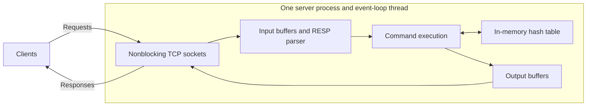
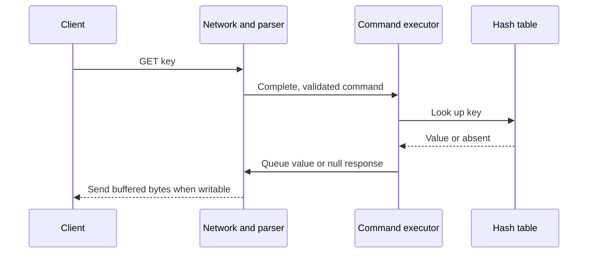
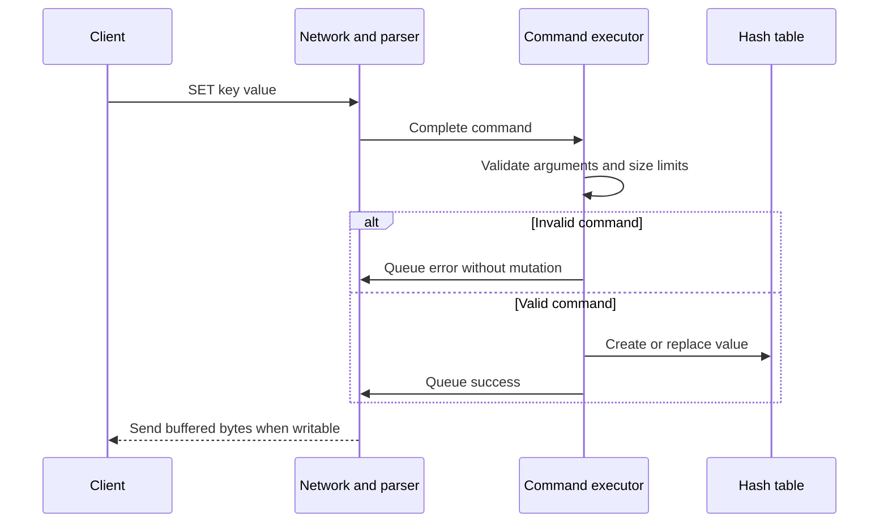

# Step 4: Minimal Single-Node Design

Build one in-memory key-value store to understand the event loop and request
paths. The [C++ prototype](prototype/README.md) implements this baseline; the
[report](implementation-report.md) records its verification.

The first implementation supports GET, SET, and DEL over nonblocking TCP, plus
PING for readiness. Expiration, eviction, persistence, replication, and sharding
remain later study phases. The broader [requirements](requirements-and-capacity.md)
provide context for those later phases.

## Architecture

One OS thread runs the event loop and owns the hash table and client buffers.
The boxes below describe responsibilities within that thread.



The listening socket and connected client sockets share one epoll instance.
Accepting connections and executing commands happen on the same thread. A socket
read may contain part of a command or several commands, so TCP reads are buffered
until complete commands can be parsed.

## Data Model and Commands

```text
key bytes -> value bytes
```

- `GET key`: return the current value, or a null reply for an absent key.
- `SET key value`: create or replace a value, then acknowledge success.
- `DEL key`: remove the key and return 1, or return 0 if absent.
- `PING`: return PONG for readiness checks.

Validate command arity and key/value sizes before accessing or mutating storage.
Each command executes completely before another begins. Commands on one connection
retain their order; scheduling determines order across different clients.

## Read Path



## Write Path



DEL follows the same path, removing a key instead of storing a value.

## Buffering and Fairness

Socket I/O is nonblocking. Keep per-client input and output buffers, retain unsent
bytes across partial writes, and request write-ready events only when output is
pending. Bound connection count, request sizes, and buffers.

Limit work per client per pass so idle or slow clients do not prevent others from
making progress. Process already-buffered complete commands on subsequent passes,
even when no new read event arrives. A long command still delays other commands;
this prototype does not parallelize execution.

## Limits and Deferred Work

A successful SET confirms an update in memory. A crash or restart loses the
entire dataset. Losing the connection before a response leaves the command's
outcome uncertain to the client.

The dataset has no configured capacity or eviction policy. TTLs, bounded dataset
memory, persistence, replication/failover, and sharding belong to the
[following phases](design-tradeoffs.md). They have documentation outlines and
future issues, with no implementation hooks in this baseline.
